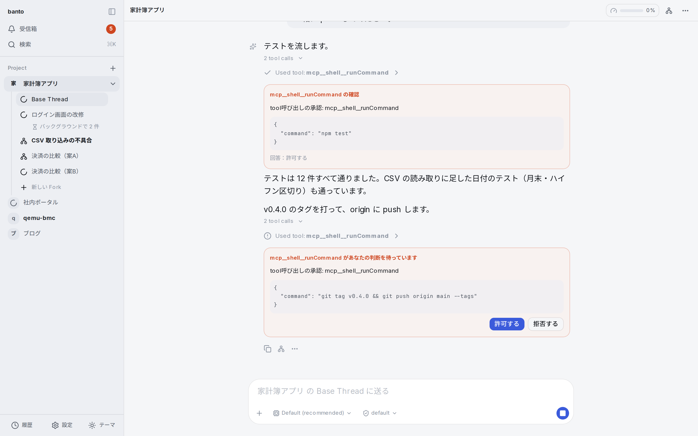
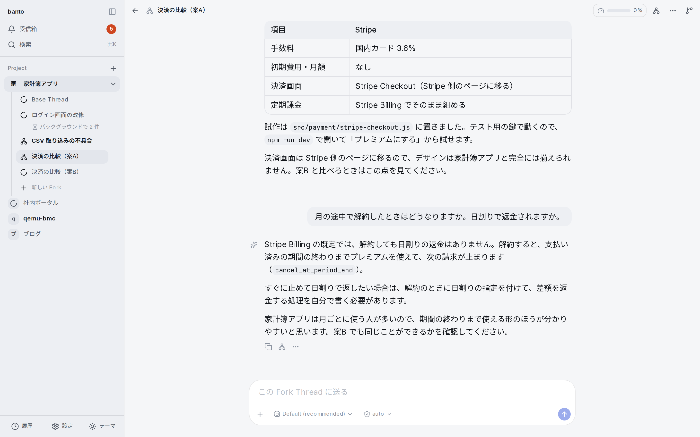
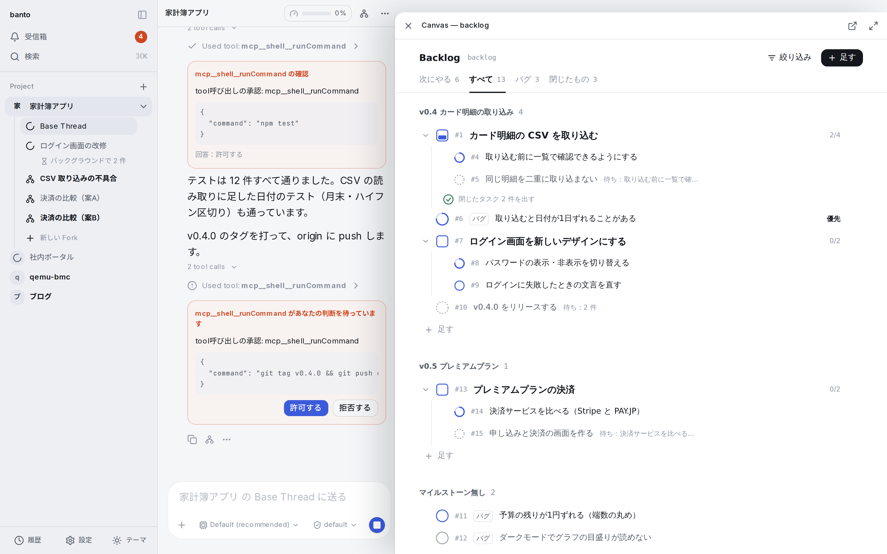
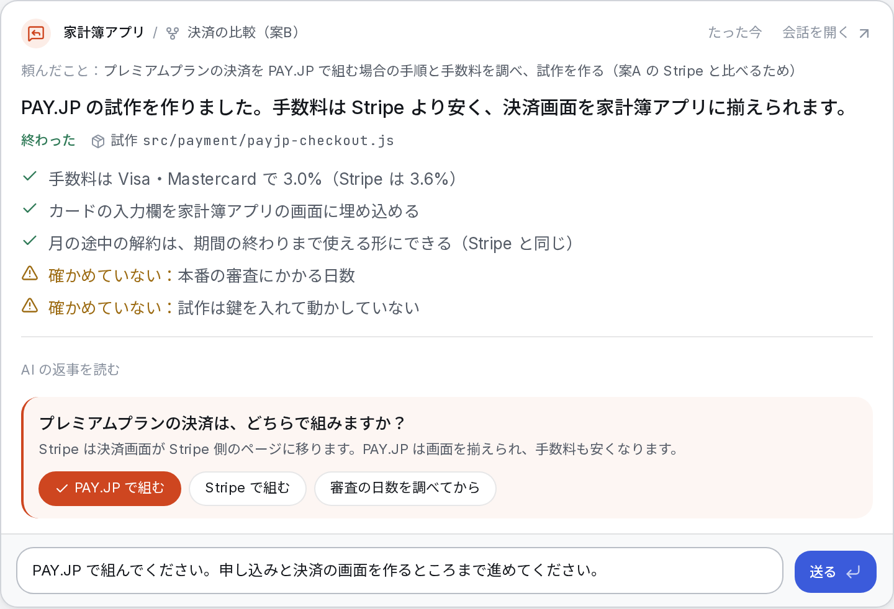
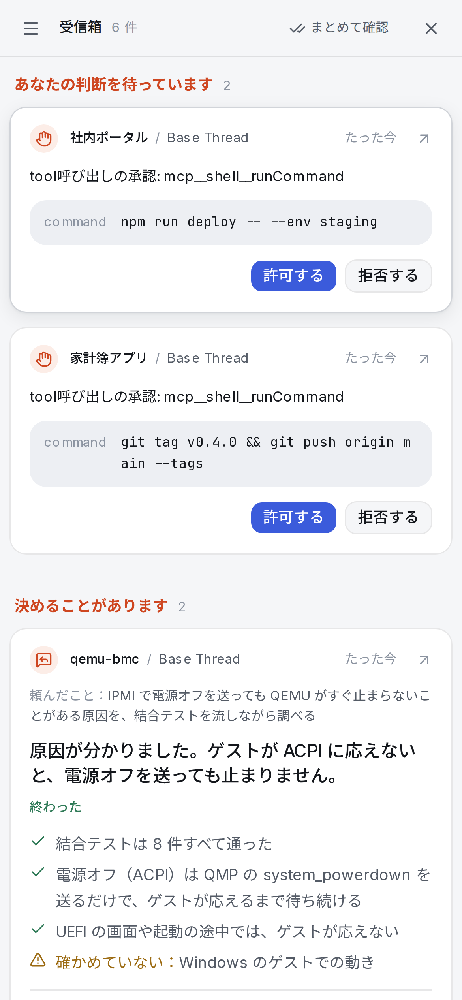

# banto

[English](README.md) | **日本語**

複数の AI エージェントに並行して作業を任せても、進捗と確認待ちをひと目で把握できる、自分のサーバーで動かすワークスペースです。

**公式サイト・ドキュメント：[banto.tjst-t.dev](https://banto.tjst-t.dev)**



## 解決したい課題

AI エージェントに作業を依頼すると、完了までに待ち時間が発生します。その間に別の作業を依頼し、別のプロジェクトにも着手する——並行して進める作業が増えるほど、「どの作業がどこまで進んでいるか」「どれが自分の確認を待っているか」を覚えておく負担が大きくなります。

banto の目的は、並行作業の数を増やすことそのものではなく、**作業をいくつ並行させても、人が覚えておくべきことが増えないようにすること**です。

## できること

- **作業の状態をひと目で把握する**：プロジェクトと会話はサイドバーに一覧表示され、AI が作業中の会話や未読の返信がある会話が区別されます。承認依頼や、作業が終わって返ってきた会話は**受信箱**に集まり、その場で読んで答え、次の指示を返信できます。
- **会話を分岐させて、複数の案を並行して試す**：会話を **Fork** で分岐し、同じ依頼から複数の実装方針を試したり、本題を止めずに調査を切り出したりできます。決まった事項はプロジェクトの **Memory** に記録され、どの Fork にも引き継がれます。
- **組み込みのツールを AI と人で共有する**：コマンドの実行、ファイル操作、ブラウザ、シークレットの管理（Vault）、開発サーバーの起動と公開、バックログ管理などを**モジュール**として備えています。AI からはツールとして、人からは画面として使えます。モジュールは MCP で繋がります。
- **定型の開発フローを自動化する**：**Factory** に Backlog のタスクを渡すと、worktree の作成・実装・テスト・レビュー・`main` へのマージまでを自動で進めます。人が対応するのは処理が止まったときだけです。
- **安全に任せる**：AI の操作はプロジェクトごとのコンテナの中で行われます。確認したい操作は実行前に承認を求めるように設定でき、シークレットの値が AI に渡ることはありません。
- **スマートフォンから使う**：承認への回答や受信箱の確認を、スマートフォンのブラウザから行えます。

| Fork で案を比べる | モジュールを Canvas で開く |
|---|---|
|  |  |

| 受信箱のカード | スマートフォン |
|---|---|
|  |  |

## 動作環境

| 項目 | 要件 |
|---|---|
| サーバー | Ubuntu 24.04 または 26.04（amd64 / arm64）。仮想マシンでも可 |
| ユーザー | sudo 権限のある一般ユーザー（root では実行できません） |
| ドメイン名 | banto に割り当てるドメイン名（例：`banto.example.com`） |
| AI | Claude のアカウント（Claude Code にログインして使用） |
| 操作する端末 | 最新のブラウザが動作するパソコン・スマートフォン |

banto は現在、1人で使うことを前提にしています。

## インストール

```sh
curl -fsSL https://banto.tjst-t.dev/install.sh | bash -s -- --domain banto.example.com
```

途中で sudo のパスワードと、Cloudflare の API トークン（任意。DNS レコードと証明書を自動で設定します）の入力を求められます。完了するとアクセス先の URL とログイン用のリンクが表示されます。ログインしたら「設定」→「ログイン」でパスキーを登録してください。

詳しい手順とオプションは[クイックスタート](https://banto.tjst-t.dev/docs/quickstart/)と[インストール](https://banto.tjst-t.dev/docs/install/)を参照してください。

## リポジトリの構成

| パス | 内容 |
|---|---|
| `banto/` | アプリケーション本体（npm workspaces）：`packages/core`（ホスト）、`packages/modules/*`（同梱のモジュール）、`apps/frontend`（Next.js の画面）、`e2e/` |
| `docs/specs/` | 設計の仕様（決まったこと） |
| `docs/notes/` | 検討の経緯と実測 |
| `site/` | 公式サイトとドキュメント（Astro Starlight） |
| `install.sh` | インストーラ |
