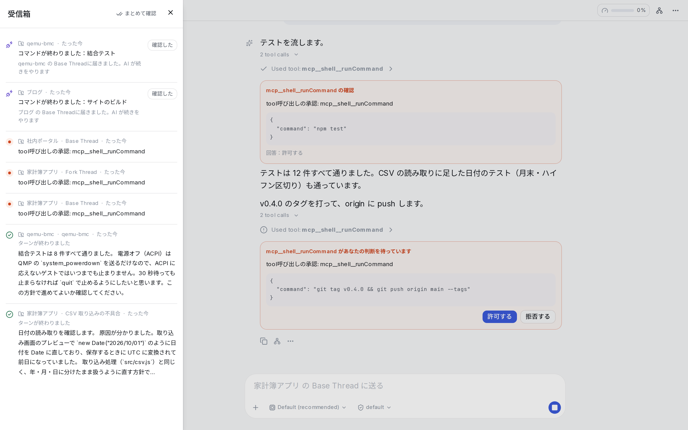

## 受信箱

受信箱には、すべてのプロジェクトの「あなたの番になったもの」だけが集まります。会話を1つずつ開かなくても、受信箱の中で内容を読み、承認し、次の指示を返せます。

サイドバー上部の「受信箱」を選ぶと、会話と同じ場所に全面で開きます。× または Esc キーで閉じます。

### 表示されるもの

上から次の順に並びます。それぞれの中は新しい順です。

| 区分 | 内容 |
|---|---|
| あなたの判断を待っています | AI からの承認依頼（コマンドの実行など）や、選択肢から選ぶ必要がある質問 |
| 決めることがあります | AI の作業が終わり、まとめの中にあなたに決めてほしいことがある会話 |
| 返ってきた会話 | AI の作業が終わり、あなたに返ってきた会話 |
| 直してほしいこと | Claude のログインが切れた、モジュールに接続できない、自動での再開を止めた、など、人が対応する必要がある問題 |

AI がバックグラウンドの処理（サブエージェントや時間のかかるコマンドなど）の完了を待っている間は、まだ作業の途中なので、受信箱には出ません。途中で止まった・失敗した会話は出ます。

サイドバーの受信箱の件数は、「あなたの判断を待っています」と「決めることがあります」の合計です。返ってきただけの会話は数えません。

### カードの見方

各項目はカードで表示され、先頭にプロジェクト名・会話名・経過時間・「会話を開く」が並びます。

**判断待ちのカード**には、何を承認するか（実行するコマンドなど）と、答えのボタンが表示されます。ボタンを押すと、その場で回答が送られます。

**返ってきた会話のカード**には、AI の作業の結果が表示されます。

- [会話の終わりのまとめ](/docs/guide/threads/#会話の終わりのまとめ)を有効にしている場合は、依頼内容・結果・作成したもの・分かったこと・確認していないこと・決めてほしいことが表示されます。AI の返事の本文は「AI の返事を読む」で開けます
- まとめがない場合は、あなたの発言と AI の最後の返事が表示されます
- 決めてほしいことには、回答の候補がボタンで表示されます。押すと返信の欄に入ります
- 確認できる URL（プレビュー用に公開した画面など）があれば、ボタンから開けます

### 受信箱から返信する

返ってきた会話のカードの下に、返信の欄があります。

- 入力して送ると、その会話に送信され、AI が作業を再開します。カードは一覧から外れます
- 欄が空のときは、AI が提案した「次に頼めること」がボタンで表示されます
- 返信せずに確認だけ済ませる場合は「見た」を押します

途中で止まった会話のカードでは、返信の欄の横に「続ける」が表示されます。

### キーボード操作

パソコンでは、次のキーで操作できます。

| キー | 操作 |
|---|---|
| J / K | 次のカード / 前のカード |
| R | 返信の欄に移動 |
| E | 見た |
| O | 会話を開く |

答える・送る・見たにすると、次のカードに移ります。

## 承認

AI がコマンドの実行やファイルの書き換えなどを行う際、操作の内容と権限モードに応じて承認を求めます。承認の依頼は会話の中にカードとして表示され、受信箱にも追加されます。どちらで答えても構いません。

- 内容を確認し、「許可する」または「拒否する」を選びます
- AI が選択肢つきで判断を求めてきた場合は、選択肢を選ぶとそのまま回答が送信されます
- 入力欄のある質問（フォーム）には、会話を開いて答えます

承認を待っている間、AI の作業はそこで止まっています。別の会話やプロジェクトに移動しても、承認するまで待ち続けます。

### 権限モード

会話ごとに、入力欄の横で権限モードを切り替えられます。

| モード | 動作 |
|---|---|
| `default` | ファイルの編集やコマンドの実行の前に確認を求める |
| `acceptEdits` | ファイルの編集は確認なしで行い、コマンドの実行などは確認を求める |
| `plan` | 計画だけを立て、ファイルの編集やコマンドの実行は行わない |
| `bypassPermissions` | 確認なしで実行する |

`bypassPermissions` の間は、破壊的なコマンドも確認なしで実行されます。コンテナで隔離されているとはいえ、プロジェクトのフォルダ内のファイルは削除されうるため、注意して使ってください。

### モジュール間の確認

モジュールが別のモジュールの機能を使う場合（例：Backlog が Repositories を通じて GitHub に push する）にも、初回は承認を求めることがあります。

### すべての承認を自動で許可する

プロジェクトの設定の「一般」→「承認」で「承認をすべて自動で許可する」を有効にすると、そのプロジェクトのすべての承認が自動で許可されます。有効な間は、入力欄の横に「自動で許可中」と表示されます。自動で許可した操作も、会話には「自動で許可しました」として記録されます。

次の操作は、この設定を有効にしても自動では許可されません。

- パスキーによる本人確認
- 人が値を入力する操作（シークレットの登録、ログインなど）
- AI が選択肢つきで判断を求める質問
